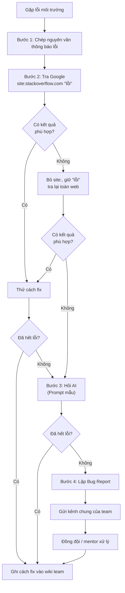

# Yêu cầu đầu ra:

## 1/ Sơ đồ luồng (Flowchart) khi thành viên gặp lỗi
 

## Kịch bản:
Bước 1: Google

`site:stackoverflow.com "<thông báo lỗi nguyên văn>"`

Bước 2

```Môi trường: <HĐH, công cụ, phiên bản>

Lỗi: <dán nguyên văn>

Đã thử: <câu Google đã dùng + kết quả>

Yêu cầu: Nêu nguyên nhân, các bước sửa, lệnh kiểm tra.
```